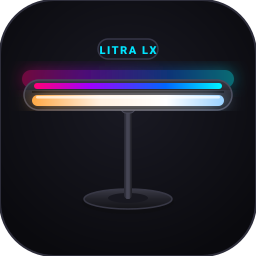

# Elgato Stream Deck – Logitech Litra Beam & Beam LX

A high-performance Stream Deck plugin for controlling Logitech Litra lights, with full support for **Litra Beam**, **Litra Beam LX**, and **multi-light pairing & synchronization**.



## Features & Optimizations
- **Multi-Light Pairing & Sync**: Pair and synchronize two or more Litra lights simultaneously. Toggle between `SYNC ALL`, `SOLO #1`, and `SOLO #2` from your Stream Deck keys or target specific lights in the Property Inspector.
- **Separate Front & Back Control**: Independently toggle, dim, and adjust color temperature for the front light and RGB effects for the back light.
- **RGB Backlight Gradients**: Create smooth 2-color gradients across the 7 back-light zones of the Litra Beam LX.
- **Custom Color & Gradient Presets**: Save your favorite colors and gradients into a library and cycle through them with a single button.
- **Windows HID Overlapped I/O Pacing**: Inter-packet report pacing and per-device connection isolation prevent Windows driver hangs (`0x000003E5`).
- **Failure Isolation**: If one light is powered off at the physical switch or unplugged, other paired lights continue to respond immediately without freezing the Stream Deck.
- **Auto Power Off**: Automatically turns off all lights when the Stream Deck application quits.

## Installation

Until this is listed on the Elgato Marketplace, you can build it manually:

1. **Prerequisites**: 
   - [Go 1.24+](https://go.dev/dl/)
   - [just](https://github.com/casey/just) command runner
   - [TDM-GCC-64](https://jmeubank.github.io/tdm-gcc/) (on Windows for CGO HID linking)
2. **Build & Link**:
   ```powershell
   just build
   just link
   ```
3. **Restart**: Restart your Stream Deck application (or run `just restart`).
4. **Configure**: Drag the "Logitech Litra" actions onto your keys and use the Property Inspector to set targets, colors, and presets.

## Development

If you're looking to contribute or want to know how to build and release the plugin, please see [DEVELOPMENT.md](./DEVELOPMENT.md).

## Acknowledgments & Inspiration

Special thanks and credit to [Michael Abon](https://github.com/michaelabon/streamdeck-logitech-litra-lights) for the original single-light plugin foundation and HID reverse engineering that inspired this project.

## License

GNU General Public License v3.0, available at [LICENSE](./LICENSE).
